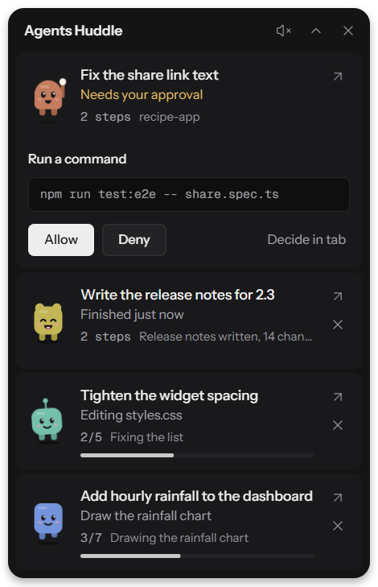
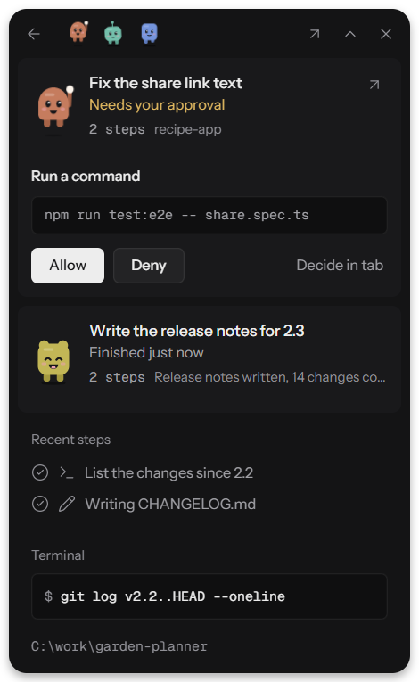

# Agents Huddle

A small always-on-top widget for Windows that shows what each Claude Code session is doing. You can allow or deny its requests without opening the editor.

<p>
  
  
</p>

## What it shows

- One figure per session, with its task, what it is doing now and its progress through its plan
- A request card when a session needs permission, showing exactly what would run or change, with Allow, Deny or Decide in tab. Requests too long to show, or that ask to run outside the sandbox, can only be decided in the tab.
- Questions a session asks, with its options as buttons
- The plan, recent steps and last terminal output of any session you open

The figures dance while their session works, jump when it needs you and hop once when it finishes. The session you messaged most recently is orange, and older ones shade through green to blue. Sound is off until you turn it on.

## Run it

Needs Node.js 20 or later on the PATH, since the hooks run under Node.

```
npm install
npm start
```

The widget opens in the top right corner, with a button on the taskbar. The cross minimises it to the taskbar. To quit, right-click its taskbar button and choose **Close window**. Settings sit in the menu of its tray icon.

Click **Connect Claude Code** once. This adds hooks to `~/.claude/settings.json` and keeps a copy of the file as it was. Sessions started after that appear in the widget.

To look at the interface with made-up sessions, run `npm run demo`.

To connect or disconnect from a terminal instead:

```
npm run hooks install
npm run hooks remove
npm run hooks status
```

## Build

```
npm run package
```

This writes a standalone app to `dist/Agents Huddle-win32-x64`.

## How it works

Each hook runs a short relay script that forwards the event to the widget over a local named pipe. Nothing leaves the computer. Before the relay sends anything, the widget must prove it knows a secret kept in your own profile folder. So another account on the same computer can neither read your sessions nor answer for them.

Permission requests and questions wait for your answer for up to five minutes. After that, or whenever the widget is minimised, closed or not running, the session asks in its own tab as usual. The relay always exits cleanly, so a missing widget never blocks a session.

## Known limits

- Tested on Windows 11 only
- Allowing and denying were tested end to end. Answering a question from the widget follows the documented hook format but has not yet been tested in an interactive session.
- Hooks must sit in the user settings file. In testing, hooks in a project's own settings file did not run for sessions in the VS Code extension.
- Open in VS Code opens the session's folder. It cannot select a particular chat tab.

## Tests

```
npm test
```

## Licence

MIT. You can use, change and share it, as long as the copyright notice stays with it. To cite it, use **Cite this repository** on the GitHub page.
